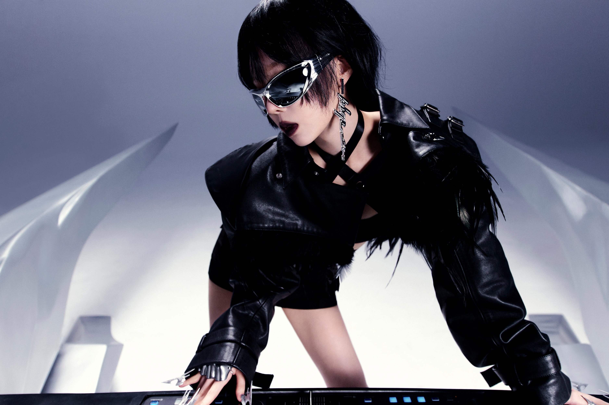
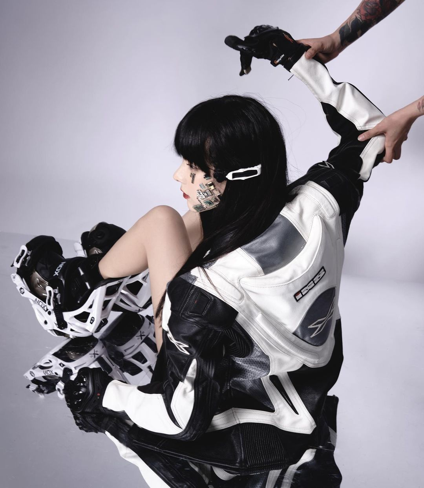

Music performances have become an important source of visual inspiration for contemporary design. Metallic accessories, experimental silhouettes and futuristic styling frequently appear in stage productions, music videos and fashion editorials.

These visual elements also share noticeable similarities with the design language of modern consumer electronics.

## The visual language of performance

Stage styling is designed to create an immediate impression. Outfits often incorporate reflective materials, sculptural accessories, unusual proportions and high-contrast details that remain visible under dramatic lighting.

In contemporary pop performances, cyber-inspired clothing and metallic finishes are frequently combined with carefully coordinated hair, makeup and graphic elements. The result is a cohesive visual identity that extends beyond the clothing itself.

Lighting, camera angles and digital effects all contribute to the final appearance, making performance styling closely connected to graphic and digital design.

<figure>

</figure>

## Translating fashion into objects

The relationship between fashion and product design is especially visible in wearable technology. Headphones, earbuds and other portable accessories occupy a space between electronic devices and personal styling. 

Designers working in these categories often incorporate visual elements associated with contemporary fashion and performance styling. Chrome and brushed silver finishes create a technical, futuristic appearance, while unconventional curves and angular silhouettes give products a distinctive profile. Combining polished and matte surfaces introduces contrast and depth without relying on additional colors. Mechanical components and visible hardware can also become intentional design details, contributing to the overall appearance of a product.

These characteristics allow everyday electronics to share the visual language of contemporary fashion.

## From concept to everyday use

A stage outfit can prioritize visual impact over practicality. Consumer products face a different set of requirements.

A pair of headphones must remain comfortable, durable and functional regardless of its appearance. This means that experimental ideas often need to be simplified before they can translate into a physical product.

The most successful applications preserve the original visual character while adapting it to everyday use.

<figure>

</figure>

## A shared creative direction

The connection between music, fashion and technology is increasingly visible in product photography, advertising and digital branding. Rather than copying specific stage looks, designers can translate their defining characteristics into new shapes, finishes and visual compositions. 

This exchange of ideas helps explain why some contemporary audio products look as though they could belong in a fashion campaign as easily as in an electronics store.