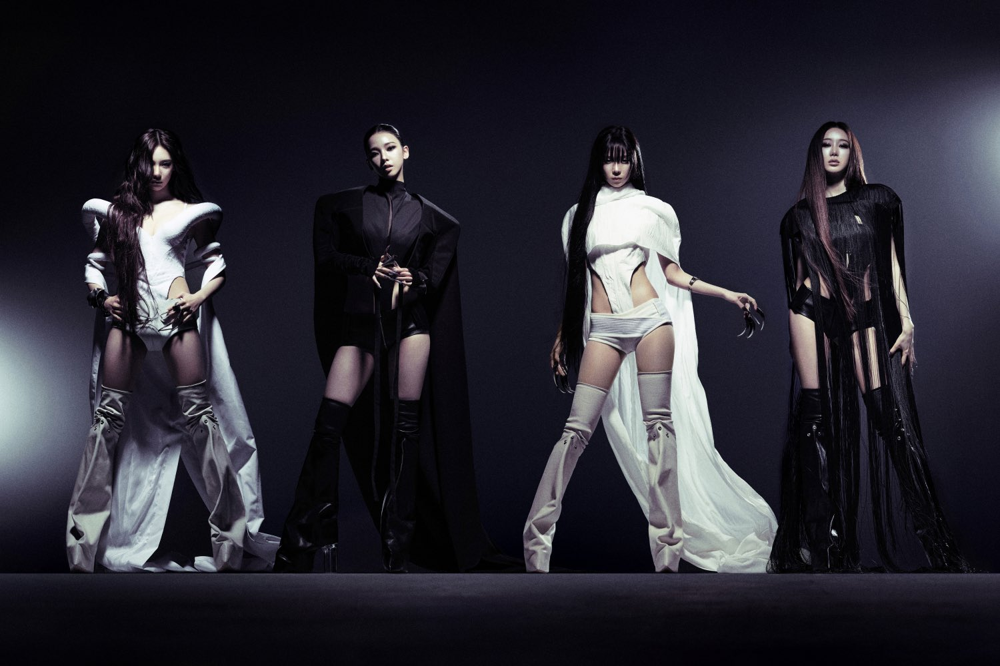

K-pop has developed a distinctive approach to visual identity, combining music, fashion, graphic design and digital media into highly coordinated concepts.

From futuristic music videos to experimental album packaging, the industry's creative direction has become a recognizable reference point for designers working across different digital platforms.

## Visual identity beyond music

Many K-pop releases are built around a specific visual concept. Typography, color, photography, styling and motion graphics are developed to create a consistent identity across promotional materials.

Concept photographs introduce the visual direction, while music videos expand it through elaborate sets, costumes and digital effects. The same aesthetic often continues through album covers, promotional websites, social media graphics and physical merchandise.

This consistency makes individual releases recognizable even when their visual direction changes significantly between projects.

<figure>

</figure>

## The influence of cyber aesthetics

Futuristic imagery has become particularly prominent in K-pop visual production. Chrome surfaces, synthetic textures, digital interfaces and unconventional typography frequently appear alongside fashion inspired by science fiction and early-2000s technology.

Metallic textures are commonly incorporated into accessories, lettering and digital compositions, while experimental typography introduces distorted shapes and unconventional layouts. Three-dimensional graphics and virtual environments allow artists to create imagery that extends beyond traditional photography.

High-contrast visuals often combine dark backgrounds with reflective surfaces, while cyber-inspired fashion incorporates technical fabrics, sculptural silhouettes and industrial details. Together, these elements create a visual language that draws from both nostalgic and futuristic references.

## Aespa's Whiplash: A case study on chrome futurism

A notable example of this visual direction is the music video for Whiplash, released by South Korean girl group aespa in October 2024.

Unlike the elaborate digital environments featured in some of the group's earlier releases, Whiplash takes a more minimalist approach. Much of the video takes place against stark white backgrounds, with monochromatic styling, metallic accessories and industrial elements establishing its futuristic atmosphere.

The video incorporates professional filming equipment as part of its visual composition, blurring the distinction between the production process and the finished performance. Rapid camera movements, unusual angles and sharp transitions complement the track's techno-influenced sound, giving the video a distinctive editorial quality.

Fashion plays a central role in establishing the concept. The members wear outfits combining runway-inspired silhouettes with technical and military influences. Restrained makeup, sleek hairstyles and carefully selected accessories reinforce the video's polished appearance.

Whiplash demonstrates how a futuristic aesthetic can be achieved through composition, styling and camera work without relying heavily on elaborate CGI. Its combination of minimal sets, experimental cinematography and high-fashion influences creates a visual identity that feels closely connected to contemporary technology and editorial design.

  <iframe
    src="https://www.youtube.com/watch?v=GjCNoZF9HxQ"
    title="aespa 에스파 'Whiplash' MV Teaser"
    loading="lazy"
    allowfullscreen referrerpolicy="strict-origin-when-cross-origin">
    </iframe>

## From music concepts to digital design

The visual language associated with K-pop has clear parallels in contemporary branding, website design and commercial photography.

Oversized typography, metallic materials, monochromatic palettes and carefully composed product imagery appear across both music promotions and technology campaigns. Similar approaches can be used to create distinctive visual identities for audio products, fashion accessories and digital platforms.

The influence is particularly visible in the way products are photographed and presented. Instead of conventional advertising layouts, brands may adopt experimental compositions, dramatic lighting and editorial styling to communicate a particular aesthetic.

However, translating these visual concepts into functional interfaces requires a different approach. While unconventional layouts can be effective in promotional imagery, websites must also maintain readable typography, accessible navigation and a clear information hierarchy.

## The future of digital aesthetics

K-pop continues to provide a wide range of visual references for contemporary designers. Its combination of music, fashion and digital production allows creative teams to experiment with new styles while maintaining recognizable artistic identities.

Projects such as aespa's Whiplash illustrate the appeal of futuristic minimalism, where restrained colors, distinctive styling and experimental camera work create a cohesive visual direction.

For brands operating at the intersection of music, technology and fashion, these approaches offer inspiration for product photography, visual identities and digital experiences.