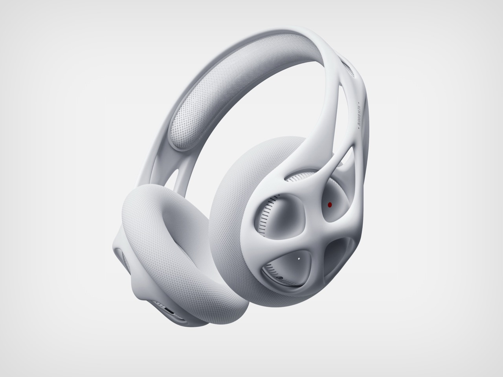

The LUMIA Pro 2 takes a restrained approach to headphone design. With its clean silhouette, light finish and carefully balanced proportions, the model reflects ECHO's interest in combining audio technology with contemporary product aesthetics.

## Shape and identity

The silhouette is one of the most recognizable aspects of any pair of headphones. The curvature of the headband, the proportions of the earcups and the way individual components connect all contribute to a product's visual identity.

For LUMIA Pro 2, the focus is on smooth geometry and a streamlined appearance. Rather than relying on aggressive angles or excessive detailing, its design emphasizes continuity between individual elements.

The result is a silhouette that feels modern without depending on an overly complicated form.

<figure>

</figure>

## The importance of color and finish

Color has a significant influence on how technology is perceived. Black remains a familiar choice in audio equipment, but lighter finishes can reveal details that darker materials often conceal.

The white finish of LUMIA Pro 2 emphasizes the product's contours and creates a sense of visual simplicity. Subtle differences in surface texture, reflections and shadow become part of its appearance.

This approach also allows the headphones to fit naturally into different visual contexts, from minimal product photography to more experimental fashion editorials.

## How proportions affect comfort

The dimensions of a pair of headphones influence more than their appearance. Earcup size, headband curvature and weight distribution all contribute to how headphones fit and feel during extended listening sessions.

These details may be less noticeable in product photography, but they play an important role in everyday use. A well-considered design needs to balance its visual proportions with practical requirements, including adjustability and comfort.

For LUMIA Pro 2, the streamlined silhouette provides a starting point for this balance between form and functionality.

## A recognizable visual language

LUMIA Pro 2 represents a design direction built around simplicity, proportion and attention to detail. Its appearance is deliberately understated, allowing the shape of the product to remain the main focus.

For ECHO, that visual consistency is an important part of building a recognizable product identity.
