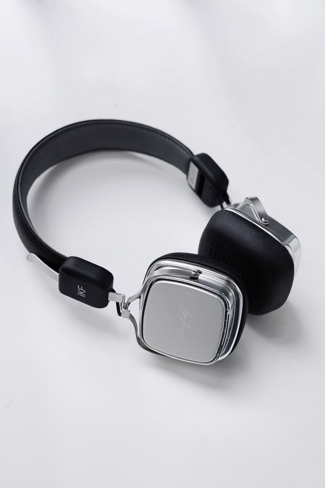
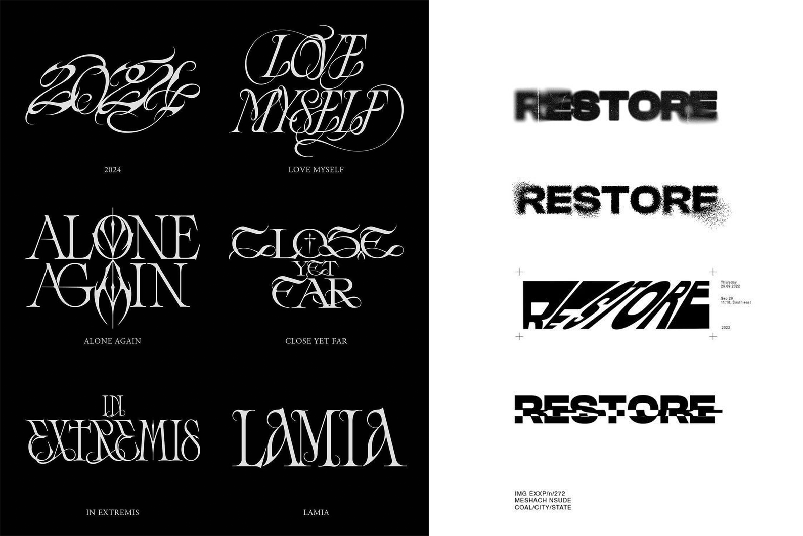
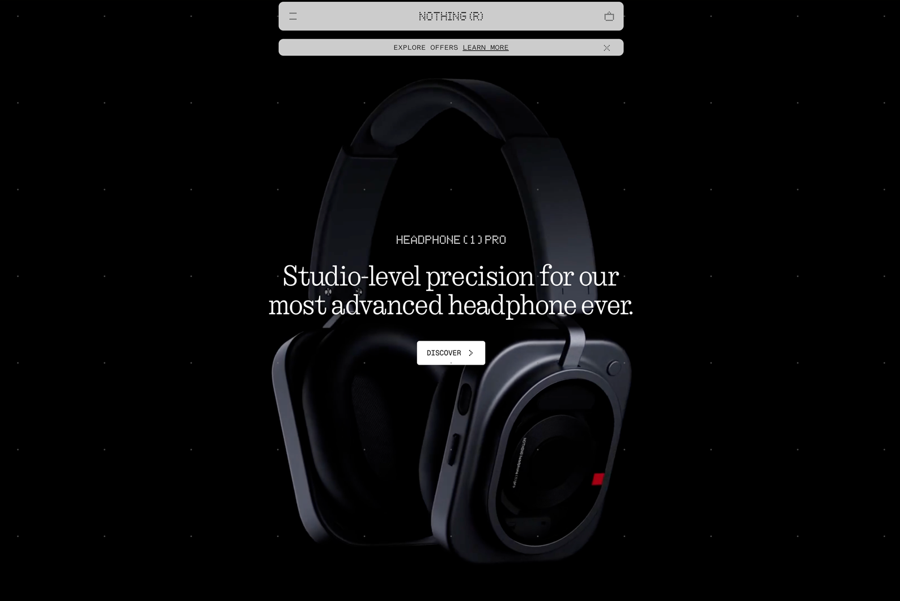
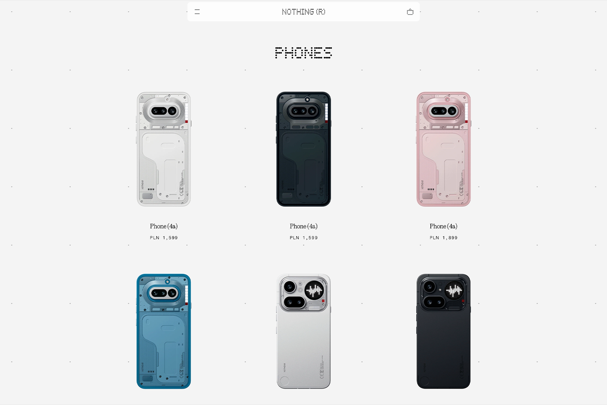
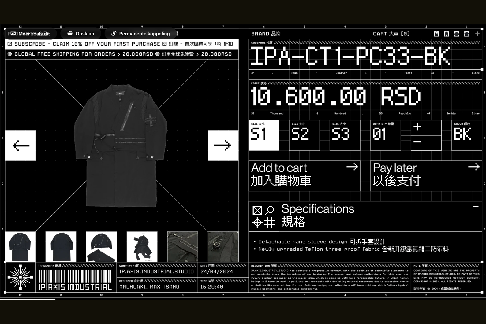
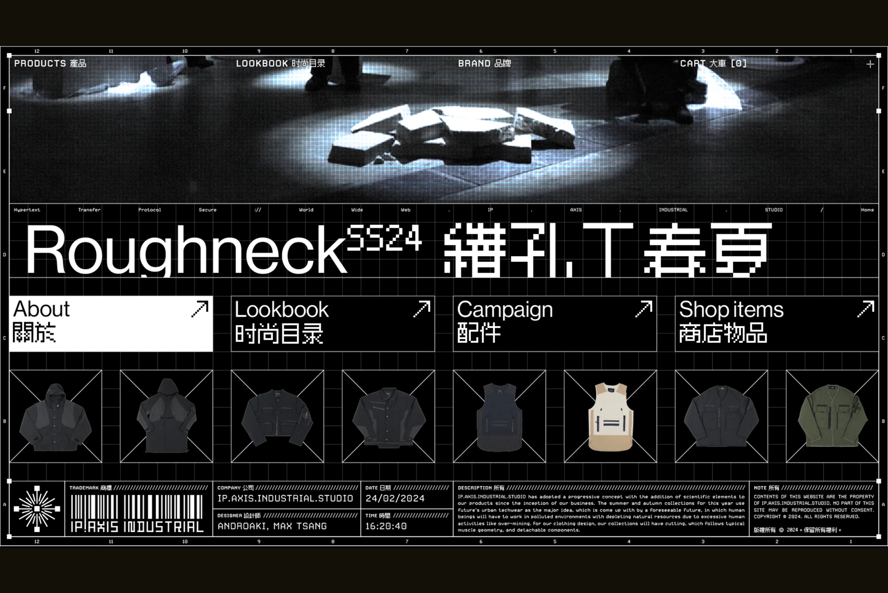

Minimalism has become a familiar visual approach in consumer technology. Neutral backgrounds, restrained typography and carefully composed product photography are common across premium electronics branding.

However, successful minimalist design requires more than removing decorative elements. Every remaining detail contributes to the overall impression.

## The appeal of visual simplicity

Technology products often contain numerous functional and technical details. In advertising and digital design, presenting all that information simultaneously can make a product difficult to understand.
Minimalist layouts address this by establishing a clear visual hierarchy. A strong product image, a short headline and a limited selection of supporting details can communicate the main message without unnecessary distractions. The approach is especially effective for audio products, where shape, materials and construction are important parts of the product's identity.

## Product photography as a design element

Clean tech visuals frequently rely on controlled studio photography.

Products are positioned against simple backgrounds, with lighting used to emphasize their form and surface details. Reflective materials such as aluminum, polished plastic and chrome introduce contrast through highlights and shadows.
A pair of silver headphones photographed against a light gray background may appear visually simple, but the final image depends heavily on the placement of reflections and the balance between light and dark surfaces.

<figure>

</figure>

This approach allows the product itself to become the central visual element.

## Typography and composition

Typography plays an equally important role in minimalist digital design. Large headings, consistent spacing and well-defined alignment can create a strong identity without elaborate graphical decoration.

<figure>

</figure>

### Common techniques include:
- Restrained color palettes built around black, white and neutral tones.
- Oversized headings paired with smaller, functional body text.
- Generous negative space between interface elements.
- Simple navigation structures and clearly defined calls to action.
- High-resolution product imagery with consistent lighting.

The challenge is maintaining clarity across different screen sizes. A layout that looks balanced on a desktop monitor may need significant adjustments for a mobile display.

<figure>

</figure>

<figure>

</figure>

## Where minimalism falls short

Minimalism can become ineffective when visual simplicity takes priority over usability. Extremely small text, insufficient contrast and hidden navigation may create a clean appearance but make interfaces difficult to understand. Similarly, removing too much product information can leave users without the details they need to make a purchasing decision. Good minimalist design maintains a balance between aesthetic restraint and practical communication.

<figure>

</figure>

<figure>

</figure>

## The direction of modern tech branding

Clean layouts continue to provide a useful foundation for contemporary technology brands.
When combined with distinctive imagery, considered typography and recognizable product forms, minimalism can support a strong visual identity without relying on excessive decoration. The result is a design approach that feels precise, intentional and adaptable across different digital platforms.